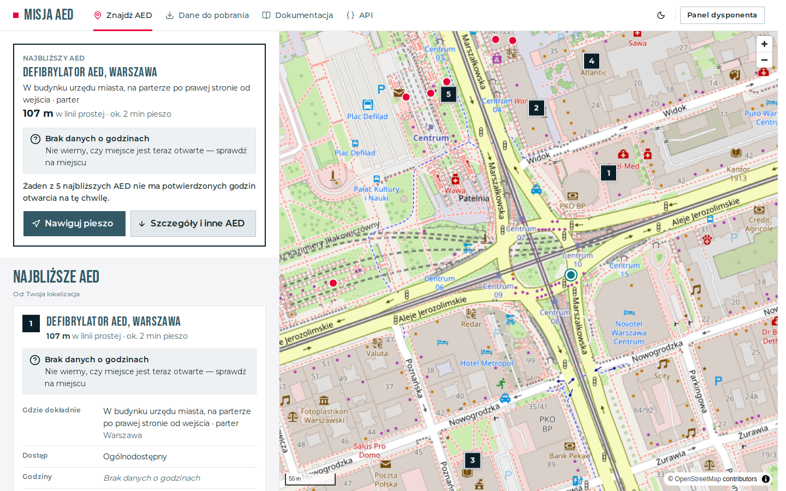
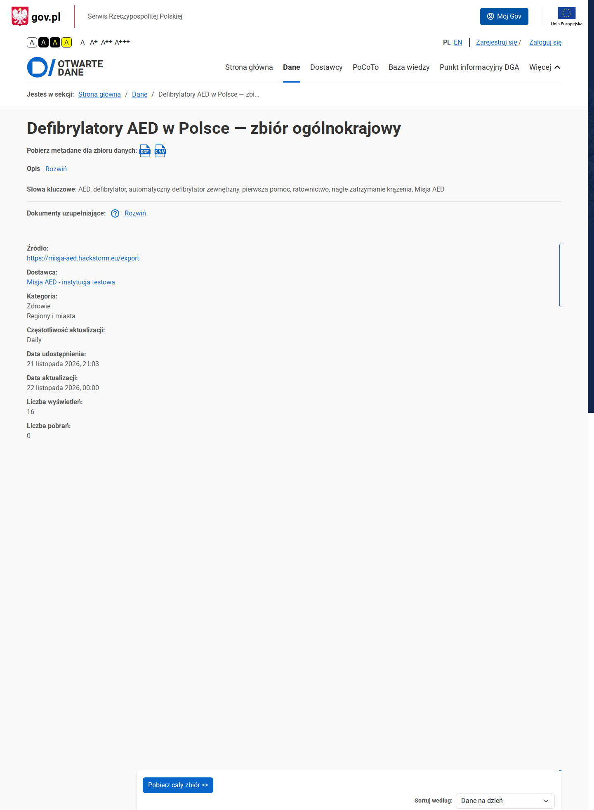
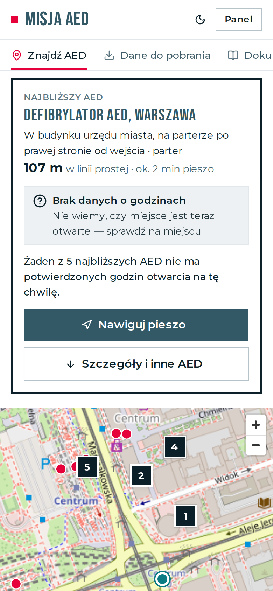

<div align="center">


# Misja AED — Dane na ratunek

**Jeden ogólnopolski, otwarty zbiór defibrylatorów AED — gotowy do publikacji na dane.gov.pl.**

*Pokaż AED, zanim ktoś będzie go szukał.* · #OtwarteAED

HackNation 2026 · wyzwanie Ministerstwa Cyfryzacji

</div>

> **Dwie części tego pliku.** Część 1 to skrót dla jury: co zrobiliśmy i gdzie to zobaczyć w 4 minuty. Część 2
> to dokumentacja techniczna dla programistów (architektura, synchronizacja, scalanie, uruchomienie).
> Part 2 is the developer documentation, in English.

---

# Część 1 — Dla jury (4 minuty)

## Co to jest

Przy zatrzymaniu krążenia liczy się każda minuta, a w Polsce nie ma jednego rejestru AED: dane są rozproszone między
OpenStreetMap, portale miast i arkusze dysponentów. Zebraliśmy je w **jeden zbiór (18 821 urządzeń)**, odpowiadający
na trzy pytania ratownika: **gdzie jest AED, czy jest teraz dostępny i czy działa**. Zbiór publikujemy w formacie
zgodnym z dane.gov.pl, a dysponentom dajemy **wzorcowy zakres danych**, by każdy publikował tak samo.

<table>
<tr>
<td width="33%"></td>
<td width="33%"></td>
<td width="33%"></td>
</tr>
<tr>
<td align="center">Najbliższe AED, „otwarte teraz”</td>
<td align="center">Zbiór zaimportowany przez portal</td>
<td align="center">Telefon (RWD)</td>
</tr>
</table>

## Zobacz w 4 minuty

| Czas | Co | Gdzie |
|---|---|---|
| 1 min | **Wyszukiwarka dla każdego** (bez logowania): najbliższe AED od lokalizacji, adresu lub punktu na mapie; czy otwarte teraz, jak wejść, gdzie dokładnie stoi, czy sprawne | https://misja-aed.hackstorm.eu |
| 1 min | **Dane do pobrania**: CSV, GeoJSON, JSON, JSON-LD, API, szablon XLSX, metadane dla portalu | https://misja-aed.hackstorm.eu/export |
| 1 min | **Import do portalu**: plik harvestera, który dane.gov.pl pobiera codziennie, i efekt na kopii testowej portalu | [harvester.xml](https://misja-aed.hackstorm.eu/api/export/harvester.xml) · [zbiór w portalu](https://dane.hackstorm.eu/pl/dataset/4214,defibrylatory-aed-w-polsce-zbior-ogolnokrajowy) |
| 1 min | **Wideo** (bez głosu, z napisami): pełna ścieżka od mieszkańca do portalu | [demo A, 4:23](deliverables/demo/misja-aed-demo-A-pelna-sciezka.mp4) · [B: wg kryteriów oceny](deliverables/demo/misja-aed-demo-B-kryteria-jury.mp4) · [C: historia ratunku](deliverables/demo/misja-aed-demo-C-historia-ratunku.mp4) |

API zgodne ze Standardem API: https://misja-aed.hackstorm.eu/api/v1/docs

## Kryteria oceny → gdzie to jest

| Kryterium | Waga | Co zrobiliśmy | Dowód |
|---|---|---|---|
| **Zgodność z zasadami dane.gov.pl** | 30% | Zbiór opisany metadanymi w schemacie harvestera XML 1.13 (z sumą MD5), importowany automatycznie raz na dobę. CSV z metadanymi CSVW, JSON-LD (5★ w ocenie portalu), GeoJSON, JSON, API. Każdy dzień danych ma niezmienny adres. Sprawdzone kodem samego portalu (walidacja XSD, ocena jakości, test linków). Odstępstwa od zaleceń (licencja, adres API) opisane w „Informacje o zbiorze” | [opis projektu](deliverables/opis-projektu.md) · [publikacja](docs/publikacja.mdx) · [zrzuty z portalu](deliverables/screenshots) |
| **Logo i hasło** | 25% | Kampania **Otwarte AED**: znak „<3” obrócony o 90°, złożony z danych, hasło „Pokaż AED, zanim ktoś będzie go szukał.”, księga znaku (12 stron), logo w JPG, PNG, PDF i SVG, naklejka na szafkę AED | [księga znaku (PDF)](marketing/ksiega-znaku.pdf) · [koncepcja](marketing/README.md) · [logo](marketing/logo) |
| **Kreatywność i innowacyjność** | 15% | Lokalny model językowy czyta opisy tekstowe („w portierni, klucz u sołtysa”) i wyciąga z nich godziny, piętro i warunki dostępu. Jego odpowiedzi mają najniższy priorytet, są oznaczone „AI” i nigdy nie zastępują danych ze źródła. Gmina i miejscowość ze współrzędnych (granice PRG). Wyszukiwarka wie, że AED w zamkniętym budynku jest nocą bezużyteczny | [raport z testu modelu](docs/llm-extraction/report.mdx) · [gmina i miejscowość](docs/gmina-i-miejscowosc.mdx) · [oświadczenie o AI](deliverables/oswiadczenie-ai.md) |
| **Dopasowanie do wyzwania** | 15% | Wszystkie źródła AED dostępne dziś na dane.gov.pl (Warszawa, Krosno, Przemyśl, Marki, Legionowo) plus OpenStreetMap w jednym zbiorze, z pochodzeniem każdej wartości. Dysponent dostarcza plik w szablonie, a jego dane wygrywają ze źródłami otwartymi | [źródła danych](docs/zrodla-danych.mdx) · [pliki dysponenta](docs/integrations/operator-files.mdx) |
| **Wzorcowy zakres danych** | 10% | 59 pól na 3 poziomach (podstawowy, rozszerzony, pełny) w XLSX: arkusze „Wzorcowy zakres danych”, „Słownik pól”, „Dozwolone wartości”, „Instrukcja”. Ten sam szablon jest zasobem w portalu | [wzorcowy-zakres-danych-aed.xlsx](deliverables/wzorcowy-zakres-danych-aed.xlsx) · [szablon](deliverables/wzorcowy-zakres-danych-aed-szablon.xlsx) · [przykładowy plik dysponenta](deliverables/przyklad-plik-dysponenta.csv) |
| **Prezentacja kompletnego rozwiązania** | 5% | Trzy wersje wideo z napisami, zrzuty ekranu z komputera i telefonu, opis kroków użytkownika i ograniczeń | [deliverables/demo](deliverables/demo/README.md) · [opis projektu](deliverables/opis-projektu.md) |

Wymagania techniczne: dane tylko w formatach maszynowo czytelnych (poza logo i księgą znaku); interfejs responsywny
(komputer i telefon); automatyczny audyt dostępności WCAG 2.2 AA (axe-core, 72 przebiegi): **120 elementów z błędami
przed poprawkami, 0 po** ([audyt](deliverables/wcag/README.md)).

## Liczby (22.11.2026)

| | |
|---|---|
| Urządzenia w zbiorze | **18 821** |
| Źródła | 6 otwartych (OSM + 5 miast) + pliki dysponentów |
| Gmina (TERYT) | 99,7% urządzeń |
| Godziny dostępności | ok. 40% urządzeń |
| Umiejscowienie (wewnątrz / na zewnątrz) | ok. 87% |
| Adres | ok. 5% (OSM go rzadko podaje; ulicy ani kodu pocztowego ze współrzędnych nie zgadujemy) |

## Wdrożenie i CI/CD

| | |
|---|---|
| Serwer | maszyna wirtualna (VMware): 32 vCPU AMD EPYC 7H12, 125 GB RAM, 491 GB dysku, Ubuntu 24.04 |
| GPU | NVIDIA A100 40 GB (vGPU): lokalny model Qwen3.8-27B w vLLM, dane nie opuszczają serwera |
| Platforma | Dokku 0.38 + Docker, dwie aplikacje: `misja-aed-api` (Django, gunicorn, Celery z harmonogramem) i `misja-aed` (Next.js), z PostgreSQL/PostGIS i Redisem |
| Ruch | Caddy (TLS) → Tailscale → Dokku, publicznie pod `misja-aed.hackstorm.eu` |

Potok: **testy lokalnie** (`npm run test`: pytest na prawdziwej bazie z zapisanymi kopiami źródeł, do tego `ruff`,
`lint`, `typecheck`) → **commit** → **`deploy.sh [gałąź] [api|web]`** wdraża tylko zatwierdzony kod i wypycha go do
Dokku → **Dokku buduje obrazy Dockera** → **`migrate`, `seed_integrations`, `ensure_admin`** przed startem →
**healthcheck** `/api/openapi.json`, dopiero potem podmiana kontenerów. Po wdrożeniu Celery co minutę sprawdza, które
źródła czekają na synchronizację, a po każdej przebudowuje eksporty, które portal pobiera raz na dobę.
Nie używamy hostowanego CI (np. GitHub Actions): testy i wdrożenie uruchamia zespół jednym poleceniem.

## Uczciwie o ograniczeniach

- **Stan techniczny AED to puste pola.** Żadne otwarte źródło nie podaje ważności elektrod i baterii ani wyniku
  autotestu. Pola są w zakresie i w imporcie dysponenta, a wypełnią się, gdy dysponenci zaczną przekazywać dane.
  Do tego służy kampania „Otwarte AED”.
- **Licencja CC BY-SA 4.0.** Ok. 96% danych pochodzi z OSM (ODbL), a portal nie ma ODbL. Wybraliśmy najbliższą
  licencję z listy portalu i dodaliśmy atrybucję OSM.
- **Model językowy może się mylić**, dlatego jego wartości mają najniższy priorytet i są oznaczone.
- **AED bez wspólnego identyfikatora** scalamy po przeglądzie w panelu, nie automatycznie (AED na różnych piętrach
  są blisko siebie, ale to różne urządzenia).

Pełna lista ograniczeń i kroki użytkowników: [opis projektu](deliverables/opis-projektu.md). Kod, testy i dokumentacja
techniczna: część 2.

## Zespół i AI

Architekturę, model danych, zakres danych i reguły scalania opracował zespół. Gdzie i jak użyliśmy AI (w działaniu
rozwiązania i przy jego tworzeniu): [oświadczenie](deliverables/oswiadczenie-ai.md).

## Badania

Badania zespołu (rejestry AED w Norwegii, Danii i Wielkiej Brytanii, katalog 56 modeli AED, normy i przepisy, notatki
do prezentacji) są w osobnym repozytorium:
[MichalZak17/hacknation-misja-aed-research](https://github.com/MichalZak17/hacknation-misja-aed-research).

---

# Część 2 — Dokumentacja techniczna

Contents: [Quick start](#quick-start) · [Architecture](#architecture) · [Sources](#sources) ·
[API contract](docs/api.md) · [Integrations](docs/integrations/README.md) · [Public docs](docs/index.mdx) ·
[dane.gov.pl requirements](docs/task/dane-gov-pl-formats.md)

## Quick start

A backend that pulls AED data from many scattered sources, validates it, merges it into one nationwide dataset and
publishes it in machine-readable formats for dane.gov.pl, plus an admin frontend built on the HackNation design system.
Requirements: Docker, [uv](https://docs.astral.sh/uv/), Node.js.

```bash
npm run setup      # uv sync (backend) + npm install (frontend)
npm run backend    # Postgres+PostGIS & Redis (Docker), migrations, Celery worker+beat, Django on 127.0.0.1:8000
npm run seed       # one-time: historical sync of every built-in source
npm run frontend   # Next.js on 127.0.0.1:3000 (proxies /api to :8000)
```

Public map for citizens (no login): http://127.0.0.1:3000/ — the nearest AEDs to your location, an address or a point
on the map, with whether each is open now, its access, location detail and readiness, and walking directions. The
admin panel starts at `/panel`.

Public download page (no login): http://127.0.0.1:3000/export — the files, the field dictionary and the metadata to
register the dataset on dane.gov.pl (each resource added by link; set `PUBLIC_BASE_URL` in `backend/.env` to the public origin).

Log in with `ADMIN_EMAIL` / `ADMIN_PASSWORD` from `backend/.env` (copy `backend/.env.example`).
API docs: http://127.0.0.1:8000/api/docs · contract: [docs/api.md](docs/api.md) · Django admin: `/admin/`.
How each source delivers data (pull vs upload, no webhooks), how to add one and what the UI can change:
[docs/integrations/](docs/integrations/README.md). Public documentation (rendered at `/docs`): the `.mdx` files in
[docs/](docs/index.mdx).

| Script | What |
|---|---|
| `npm run sync -- <slug> [--historical] [--dry-run] [--force]` | Run one sync now, in the foreground (`--all` for every source) |
| `npm run test` | Backend tests (pytest, real Postgres; feeds replaced by saved fixtures) |
| `npm run db` / `npm run db:stop` | Just the databases |
| `npm run manage -- <command>` | Any `manage.py` command |
| `npm run build` · `lint` · `typecheck` | Frontend |

## Architecture

```
backend/                       Django 6 + django-ninja, uv, Python 3.13
├── config/                    settings (.env), Celery, URLs
├── integrations/              sources and syncs
│   ├── connectors/            base.py (contract), common.py (helpers), __init__.py (registry)
│   │   └── <integration>/     one folder per source, found automatically: connector.py (fetch → raw bytes,
│   │                          parse → ParsedRecord, priority, interval), fixtures/, test_connector.py
│   ├── engine.py              lock → fetch → snapshot → parse → validate → diff → LLM extraction → write → merge
│   │                          → cache bump
│   ├── enrichment/            structured facts from free text by a local LLM (vLLM): prompt, cache, client
│   ├── live.py                live run progress for the /ai view (phase, LLM answers, tallies; Redis)
│   ├── tasks.py               run_sync_task, dispatch_due_syncs (beat, every minute)
│   └── api.py                 admin API: integrations, sync triggers, runs, records, uploads
├── devices/                   the merged dataset
│   ├── models.py              Device, MaintenanceEvent, MatchCandidate, AdminUnit (PRG boundaries)
│   ├── schema.py              the reference record (wzorcowy zakres danych) — API, exports and XLSX use it
│   ├── merge.py               stable-ID links, per-field precedence, maintenance overlay, duplicate candidates
│   ├── boundaries.py          municipality (TERYT) and town from coordinates, PRG boundaries (`load_boundaries`)
│   ├── readiness.py           ready / attention / expired / unknown
│   ├── exports.py             GeoJSON / CSV / JSON / schema XLSX+TXT, dane.gov.pl metadata and harvester XML, per data version
│   └── api.py                 public open-data API + merge review and maintenance events
└── docker-compose.yml         Postgres 17 + PostGIS (built from postgres:17, works on ARM and x86) :5434, Redis :6380
frontend/                      Next.js 16, forked from hacknation-design-system
```

**Data model.** `Integration` (one row per source: connector, URL, priority, interval, schedule) →
`SyncRun` (every run with counts, snapshot hash, change and issue details) → `SourceRecord` (the provider's own
observation: normalised `data` + original `raw`, content hash, first/last seen, removed) → `Device` (the merged AED:
identity incl. serial number, location, access, pads, battery, upkeep, status, owner, provenance per field) →
`MaintenanceEvent` (pads/battery replaced, inspection, self-test, rescue use, repair, decommissioning).

**Syncs.** Each integration has one *historical* sync (the first full load; refused a second time unless forced) and
*periodic* syncs on its own interval (`sync_interval_hours`, declared on the connector class; 24 h by default) — Celery beat checks every minute which
integrations are due. Every sync can be triggered manually (UI, API, `npm run sync`), and any sync can be a *dry run*:
fetch, parse, validate and diff against the database without writing — the way to test a new or changed connector
against the live feed. Raw downloads are kept in `backend/var/snapshots/`.

**Validation.** Coordinates present, inside Poland, inside the municipality's `config.bounds`; swapped lat/lon is fixed
and flagged (Marki); duplicate IDs and shared coordinates are flagged. Invalid records are stored with their issues
and never reach a device.

**Merging.** Records join devices through stable IDs only (OSM `ref:api-um-warszawa-pl` ↔ Warsaw `defib_id`).
Devices of different sources within `MATCH_DISTANCE_M` (25 m) become a *match candidate* for review in the UI —
nearby AEDs can be on different floors, so distance never merges automatically. Per field, the highest-priority
source wins (operator 90 > city 50–60 > OSM 10); replacement and check dates take the most recent.

**LLM extraction.** Much of what a rescuer needs is in free text ("w portierni, klucz u sołtysa", "Samochód
ratowniczo-gaśniczy", "Dostępny pon-pt 7:30-15:30"). With `LLM_ENABLED=true`, every sync sends each record's text to
a local model (the shared vLLM's Qwen3.8-27B) and stores the cleaned answer on the record as `inferred`: placement
(incl. AEDs carried in fire engines → `is_mobile`), floor, OSM `opening_hours`, access conditions, seasonal
availability, plus a position hint, enclosure and device count for review. The merge uses an inferred value only
where no source states the field, and marks it `method: "inferred"` in `field_sources` (shown as **AI** in the UI).
Answers are cached per distinct input, prompt and model, so only new or changed texts reach the model; a model that
is down never fails a sync. The first national load is ~13.4k calls, about an hour. Model choice and accuracy:
[docs/llm-extraction/report.mdx](docs/llm-extraction/report.mdx).
The admin page **Klasyfikacja AI** (`/ai`) shows this step live: the pipeline phase, every answer as it arrives (the
text the model read → the fields it returned, struck through where the source's own value wins), throughput and
running tallies. The engine reports to `integrations/live.py` (one Redis entry per run, polled through
`GET /api/runs/{id}/live`). "Klasyfikuj ponownie" queues a sync with `reextract`, which ignores the cache and asks the
model again for every text (Warsaw: 647 texts, ~3.5 min; also `manage.py sync <slug> --reextract`).

**Municipality and town from coordinates.** ~95% of devices come only from OSM, where the AED is a point inside a
building with no address. `manage.py load_boundaries` loads the cadastral-unit layer of the national boundary register
PRG (GUGiK, ~3,200 polygons, ~70 MB pulled out of the 380 MB package with range requests into `backend/var/boundaries/`)
into `AdminUnit` (PostGIS, EPSG:2180), then recomputes every device. From then on, the merge fills `teryt` and `city`
that no source states from the unit the coordinates fall in: the municipality always, the town only when the unit is a
town (unit kinds `_1`, `_4`, `_8`, `_9`; rural areas `_2`/`_5` give no town), and neither when a unit within 30 m
disagrees. They are marked `"source": "prg", "method": "geocoded"` (**Geo** in the UI). Street, house number and postal
code are never derived from coordinates: Polish postal codes belong to streets and number ranges, and the nearest
address point is often another building. Against source-stated values: town 826/826, TERYT 773/774. Details:
[docs/gmina-i-miejscowosc.mdx](docs/gmina-i-miejscowosc.mdx).

**Caching.** Redis holds the Celery broker (/0) and the cache (/1). API responses and exports are cached under a data
version that every sync, merge decision and maintenance event bumps; exports are rebuilt after each sync, served with
ETags, and copied to `backend/var/exports/`. Spatial queries (bbox, nearest, candidates) use a PostGIS generated
`geom` column with a GiST index.

## Sources

| Slug | Source | Notes |
|---|---|---|
| `osm-poland` | OpenAEDMap / OpenStreetMap | ~18.3k nodes; `check_date` → `verified_on` |
| `warszawa-19115` | Warsaw 19115 (ArcGIS snapshot) | 708; joins OSM by ID |
| `przemysl` | Przemyśl (skyCMS GeoJSON) | 21 |
| `krosno` | Krosno CSV | 21 |
| `marki` | Marki CSV-in-CSV | 8; lat/lon swapped; row 7 has Krosno's coordinates (rejected) |
| `legionowo` | Legionowo CSV | 24; no device ID → derived from name + address |

**Adding a source.** A feed we download is always defined in code: a new folder in `integrations/connectors/<slug>/`
(connector, fixture, test), found by the registry automatically, then `npm run seed`. A feed
whose columns map one-to-one can subclass the `mapped` connector and needs no parsing code
([mapped-feeds.mdx](docs/integrations/mapped-feeds.mdx)). Each source's notes are in
[docs/integrations/sources/](docs/integrations/sources/). Merge priority and sync interval are class attributes, so
changing them takes a redeploy (`seed_integrations` applies them on start). The UI never defines feeds, because real
sources need joins, value maps and derived IDs. **Operator data** (serial numbers, pads, battery,
inspections — none of the open feeds have it) comes in through an `operator_file` integration, the only kind the UI
creates (**Integracje → Nowy dysponent**): upload a CSV/XLSX in the reference schema (`/api/export/schema.xlsx` has a template sheet), dry-run it, then sync.

The merged export combines ODbL (OSM) with CC0/CC BY sources. The portal offers no ODbL, so the dataset is published
as CC BY-SA 4.0 (the closest licence) with OSM attribution in the licence conditions (`DATASET_LICENSE`).
